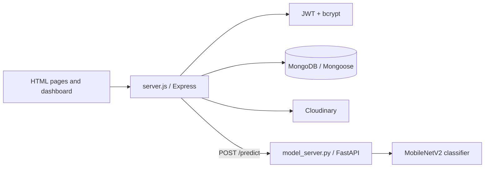

# NITK 2025 Plastic AI

Plastic AI is an educational waste-awareness prototype for identifying common waste categories and explaining disposal choices. A static browser experience presents guidance for plastic, aerosol, and lithium-battery items; a Node/Express service handles accounts and uploads; a separate FastAPI/TensorFlow service performs image inference.

## Architecture



The Node service serves the HTML pages and exposes the account, profile, and upload endpoints. `model_server.py` loads a MobileNetV2-based model and exposes a prediction endpoint. The bundled image assets and educational pages provide category-specific effects, alternatives, disposal tips, and possible reuse ideas.

## Implemented endpoints

Node (`server.js`):

- `POST /register` and `POST /login` create and authenticate users.
- `POST /upload` accepts an authenticated image upload and forwards it to the model service.
- `GET /profile` returns the authenticated profile.
- `/`, `/register.html`, `/dashboard.html`, and `/profile.html` serve the browser UI.

Model service (`model_server.py`):

- `GET /` reports service availability.
- `POST /predict` accepts an image and returns the model/category result.

These routes are implementation details rather than a versioned public API. Review the source before integrating another client.

## Local setup

Requirements: Node.js/npm, Python with the dependencies in `requirements.txt`, MongoDB, and a reachable model-service URL. Cloudinary and JWT settings are required for the corresponding features.

```bash
npm ci
npm start

# in a second environment/process
python -m venv .venv
. .venv/bin/activate
pip install -r requirements.txt
uvicorn model_server:app --host 127.0.0.1 --port 8000
```

Configure MongoDB, JWT signing, Cloudinary, model-service, and any external API settings through the deployment secret manager. Do not put credentials in HTML, browser JavaScript, or committed configuration. The exact variable names should be taken from `server.js` and the deployment environment.

## Project layout

| Path | Responsibility |
| --- | --- |
| `server.js` | Express startup, users, auth, uploads, media, model calls |
| `model_server.py` | FastAPI inference service and image preprocessing |
| `index.html` | Main educational landing page |
| `dashboard.html` | Authenticated dashboard and upload flow |
| `register.html` / `profile.html` | Account screens |
| `images/` and category JPGs | Educational illustrations and sample assets |
| `package.json` / `requirements.txt` | Node and Python dependencies |

## Deployment and operations

Deploy the Node and Python processes separately or on a private internal network, and configure the model URL with timeouts and health monitoring. Use HTTPS, least-privilege MongoDB and Cloudinary credentials, upload size/type validation, access-controlled media URLs, and explicit deletion/retention policies.

## Testing and limitations

The package manifest does not declare an automated test suite. Test registration/login failure paths, JWT expiry, upload validation, model timeouts and malformed responses, media access control, and factual accuracy of disposal guidance. Predictions are advisory and should be validated against representative local waste images; this prototype is not a substitute for regulated waste-handling advice.

## Security

Never commit database URLs, JWT secrets, Cloudinary keys, model-provider tokens, or user data. Rotate any credential exposed in repository history. Treat uploaded images and profile data as sensitive and restrict logs accordingly.

## License

See the repository license file and package metadata for the authoritative terms.
