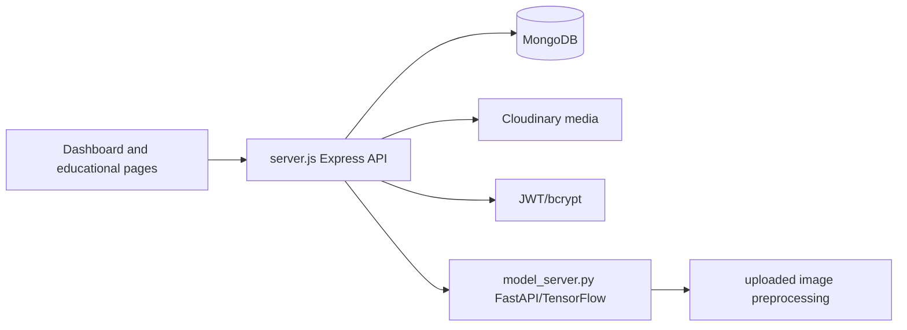

# NITK 2025 Plastic AI

An educational waste-awareness application focused on plastic, aerosol, and lithium-battery disposal. It combines a static browser dashboard and information pages with an Express/MongoDB service and a Python model endpoint for image/AI-assisted classification.

## Architecture



The HTML pages and image assets provide the education UI. `server.js` handles authentication/data/media services; `model_server.py` exposes the Python inference path.

## Setup

```bash
npm ci
npm start
# Python model service in a separate environment
pip install -r requirements.txt
uvicorn model_server:app --host 0.0.0.0 --port 8000
```

Configure MongoDB, JWT, Cloudinary, Hugging Face/API, and model-service URLs through environment variables. Never put provider credentials in client JavaScript.

## Workflow and data

Users browse disposal guidance, authenticate where required, upload or submit images, and receive stored/media-backed results. Node handles user/data operations and delegates model inference to the Python service when configured.

## Deployment

Deploy the Node and Python services separately or behind a private internal network. Use HTTPS, upload limits and content validation, least-privilege media credentials, and explicit retention/deletion controls.

## Testing and limitations

The package manifest has no automated test suite. Test authentication, upload validation, model timeout/error handling, media access control, and factual correctness of disposal guidance. Model predictions are advisory and require validation on representative local waste images.

## Security and operations

- Keep credentials, database URLs, OAuth tokens, API keys, and signing secrets in environment variables; never commit them.
- Validate and constrain uploaded files and user input at the server boundary, and enable HTTPS in production.
- Review dependency updates and rotate any credential that has appeared in repository history.

## Testing

The repository currently has no comprehensive automated test suite unless noted above. Before production changes, add tests for authentication/authorization, validation failures, persistence errors, and the primary user workflow.

## Limitations and roadmap

This is an actively evolving project. Production hardening, observability, rate limiting, backup/retention policy, and accessibility/performance validation should be completed before handling sensitive or high-volume workloads.

## License

See the repository license file and package metadata for the authoritative terms.
